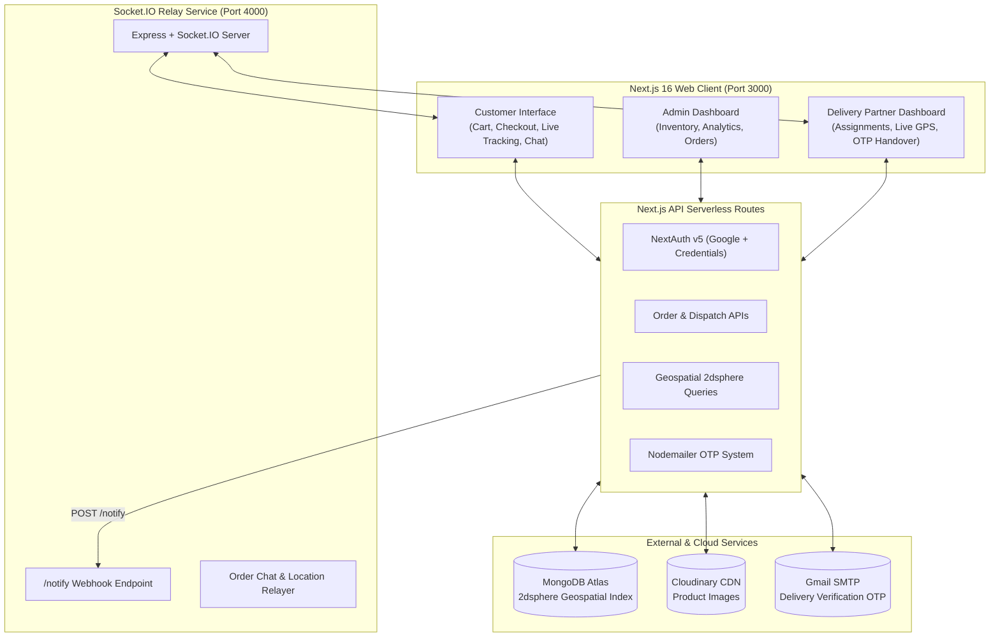

# 🛒 SnapCart — Hyperlocal Grocery Ordering & Real-Time Delivery Platform

[](https://nextjs.org/)
[](https://react.dev/)
[](https://www.typescriptlang.org/)
[](https://tailwindcss.com/)
[](https://www.mongodb.com/)
[](https://socket.io/)

A full-stack, real-time hyperlocal grocery delivery application built with **Next.js 16 (App Router)**, **React 19**, **Node.js Express + Socket.IO microservice**, and **MongoDB with Geospatial Indexing**. 

SnapCart connects **Customers**, **Store Administrators**, and **Delivery Partners** in a unified real-time ecosystem featuring live order dispatch within 10 km, GPS route tracking on interactive maps, in-app messaging, and email-based delivery OTP verification.

---

## 📑 Table of Contents

- [Key Features by Role](#-key-features-by-role)
  - [1. Customer (User)](#1-customer-user)
  - [2. Delivery Partner (Delivery Boy)](#2-delivery-partner-delivery-boy)
  - [3. Store Administrator (Admin)](#3-store-administrator-admin)
- [System Architecture](#-system-architecture)
- [Tech Stack](#-tech-stack)
- [Project Structure](#-project-structure)
- [Database Models](#-database-models)
- [Real-Time Socket & Notification System](#-real-time-socket--notification-system)
- [API Endpoints Reference](#-api-endpoints-reference)
- [Environment Variables](#-environment-variables)
- [Getting Started & Installation](#-getting-started--installation)
- [Role Workflows & End-to-End Testing](#-role-workflows--end-to-end-testing)

---

## 🚀 Key Features by Role

### 1. Customer (User)
- **Product Discovery & Category Navigation**: Filter grocery items by category (e.g., *Fruits & Vegetables*, *Dairy & Eggs*, *Instant & Packaged Food*) or search dynamically across product names and descriptions.
- **Cart & State Management**: Redux-powered persistent cart with dynamic quantity adjustments, item pricing, and automatic order subtotal calculation.
- **Interactive Map Checkout**: Pin drop on an interactive Leaflet / OpenStreetMap view with reverse geocoding to automatically capture exact delivery coordinates (`latitude` / `longitude`).
- **Live Order Tracking**: Real-time status tracker (*Pending* ➔ *Out for Delivery* ➔ *Delivered*) with an interactive live map displaying the delivery agent's real-time moving coordinates connected via dynamic polyline.
- **Direct Delivery Chat**: In-app chat interface between customer and assigned delivery agent powered by Socket.IO rooms.
- **OTP Verification Security**: 4-digit verification code sent securely via email; required by the courier to mark the delivery complete.

### 2. Delivery Partner (Delivery Boy)
- **10km Geospatial Order Dispatch**: Receives broadcast notifications for any orders placed within a 10 km radius using MongoDB `$near` 2dsphere indexing.
- **Order Acceptance Flow**: View delivery assignment requests, item counts, customer distance, and accept available assignments on a first-come basis.
- **Background GPS Broadcast**: Continuous GPS location updates streamed via `GeoUpdater` and Socket.IO to keep customer maps synced.
- **Customer Route & Details**: Interactive navigation map, customer contact number, and itemized drop-off details.
- **Direct In-App Chat**: Message the customer directly while on route.
- **Email OTP Handover**: One-click "Send OTP" triggers an email to the customer; inputting the OTP confirms the physical handover and closes the order.

### 3. Store Administrator (Admin)
- **Analytics Dashboard**: Real-time revenue analytics (Today, Last 7 Days, Lifetime Total) and sales volume visualizations rendered with **Recharts**.
- **Quick Metrics**: Real-time count of total orders, customers, delivery partners, and total revenue.
- **Inventory & Catalog Management**: Add, update, and remove grocery items with categories, units (`kg`, `g`, `liter`, `ml`, `piece`, `pack`), and Cloudinary media uploads.
- **Order Dispatch Pipeline**: View incoming orders, inspect delivery addresses, and initiate delivery dispatch to trigger the geospatial proximity search for available couriers.

---

## 🏛 System Architecture



---

## 🛠 Tech Stack

| Layer | Technologies |
|---|---|
| **Frontend Framework** | [Next.js 16.2.2](https://nextjs.org/) (App Router), [React 19.2.4](https://react.dev/), [TypeScript 5](https://www.typescriptlang.org/) |
| **Styling & Animation** | [Tailwind CSS v4](https://tailwindcss.com/), [Motion / Framer Motion 12](https://motion.dev/), [Lucide React](https://lucide.dev/), [React Icons](https://react-icons.github.io/react-icons/) |
| **State Management** | [Redux Toolkit](https://redux-toolkit.js.org/) (`@reduxjs/toolkit`), `react-redux` |
| **Mapping & Geocoding** | [Leaflet](https://leafletjs.com/), [React Leaflet 5](https://react-leaflet.js.org/), [Leaflet-GeoSearch](https://github.com/smeijer/leaflet-geosearch), OpenStreetMap |
| **Charts & Analytics** | [Recharts 3.8.1](https://recharts.org/) |
| **Authentication** | [NextAuth.js v5 Beta](https://authjs.dev/) (Credentials Auth with bcryptjs + Google OAuth 2.0) |
| **Database & ODM** | [MongoDB Atlas](https://www.mongodb.com/atlas), [Mongoose 9.4.1](https://mongoosejs.com/) (with `2dsphere` index) |
| **Real-Time Communication** | [Socket.IO 4.8.3](https://socket.io/) (Dedicated Node.js/Express microservice + Client integration) |
| **Cloud Storage** | [Cloudinary v2](https://cloudinary.com/) (Asset uploads & image optimization) |
| **Email Service** | [Nodemailer](https://nodemailer.com/) (Gmail SMTP for 4-digit OTP delivery security) |

---

## 📂 Project Structure

```text
snapcartFolder/
├── snapcart/                           # Main Next.js 16 Full-Stack Application
│   ├── public/                         # Static assets and icons
│   ├── src/
│   │   ├── app/
│   │   │   ├── admin/                  # Admin Views
│   │   │   │   ├── add-grocery/        # Form to add groceries with image upload
│   │   │   │   ├── manage-orders/      # Order listing and dispatch management
│   │   │   │   └── view-grocery/       # Catalog list with edit/delete modals
│   │   │   ├── api/                    # Serverless API Endpoints
│   │   │   │   ├── admin/              # Grocery CRUD & order status dispatch
│   │   │   │   ├── auth/               # NextAuth & registration routes
│   │   │   │   ├── chat/               # Chat history retrieval and persistence
│   │   │   │   ├── delivery/           # Assignment acceptance, live orders & OTP
│   │   │   │   ├── socket/             # User socket identity & location updates
│   │   │   │   └── user/               # Order placement and order history
│   │   │   ├── login/                  # Authentication page (Google & Credentials)
│   │   │   ├── register/               # New user onboarding page
│   │   │   ├── unauthorized/           # Role-based access denial page
│   │   │   ├── user/                   # Customer Views
│   │   │   │   ├── cart/               # Shopping cart summary page
│   │   │   │   ├── checkout/           # Address & map pin drop checkout
│   │   │   │   ├── my-orders/          # User order history
│   │   │   │   ├── order-success/      # Order placement confirmation
│   │   │   │   └── track-order/[orderId]/ # Live tracking map & real-time chat
│   │   │   ├── auth.ts                 # NextAuth v5 configuration & JWT callbacks
│   │   │   ├── layout.tsx              # Root app layout with Redux StoreProvider
│   │   │   └── page.tsx                # Role-based root switch (User, Admin, DeliveryBoy)
│   │   ├── components/                 # Reusable UI Components
│   │   │   ├── AdminDashboard.tsx      # Admin metrics & chart aggregator
│   │   │   ├── AdminDashboardClient.tsx# Recharts visualizer & revenue filters
│   │   │   ├── AdminOrderCard.tsx      # Admin order card with dispatch trigger
│   │   │   ├── CategorySlider.tsx      # Horizontal grocery category carousel
│   │   │   ├── CheckoutMap.tsx         # Leaflet pin-drop selector for checkout
│   │   │   ├── DeliveryBoy.tsx         # Delivery portal entry point
│   │   │   ├── DeliveryBoyDashboard.tsx# Active delivery, OTP inputs, maps & chat
│   │   │   ├── EditRoleMobile.tsx      # Post-signup role/mobile onboarding modal
│   │   │   ├── GeoUpdater.tsx          # Background browser geolocation streamer
│   │   │   ├── GroceryCard.tsx         # Product item card with add-to-cart
│   │   │   ├── LiveMap.tsx             # Real-time Leaflet tracking with polyline
│   │   │   ├── Nav.tsx                 # Responsive navigation bar & search
│   │   │   └── UserOrderCart.tsx       # Customer order summary card
│   │   ├── hooks/                      # Custom React hooks
│   │   ├── lib/                        # Shared Utilities & Clients
│   │   │   ├── cloudinary.ts           # Cloudinary SDK configuration
│   │   │   ├── db.ts                   # Cached MongoDB Mongoose connector
│   │   │   ├── emitEventHandler.ts     # Relay emitter to Socket server /notify
│   │   │   ├── mailer.ts               # Nodemailer transporter for delivery OTPs
│   │   │   └── socket.ts               # Socket.io client singleton
│   │   ├── models/                     # Mongoose Data Schemas
│   │   │   ├── deliveryAssignment.model.ts
│   │   │   ├── grocery.model.ts
│   │   │   ├── message.model.ts
│   │   │   ├── order.model.ts
│   │   │   └── user.model.ts
│   │   └── redux/                      # Redux Toolkit Global State
│   │       ├── cartSlice.ts            # Cart items, quantities & total state
│   │       ├── store.ts                # Redux store configuration
│   │       ├── StoreProvider.tsx       # Client-side Redux Provider wrapper
│   │       └── userSlice.ts            # Logged-in user session state
│   ├── .env                            # Application environment secrets
│   ├── next.config.ts                  # Next.js configuration
│   └── package.json                    # Frontend dependencies & scripts
│
└── socketServer/                       # Real-Time WebSocket Microservice
    ├── .env                            # Socket server port & client origin
    ├── index.js                        # Express + Socket.IO server implementation
    └── package.json                    # Socket server dependencies
```

---

## 🗄 Database Models

### 1. `User` (`user.model.ts`)
- `name`: String (required)
- `email`: String (required, unique)
- `password`: String (optional for OAuth users)
- `mobile`: String
- `role`: Enum `["user", "admin", "deliveryBoy"]` (default: `"user"`)
- `image`: String (avatar URL)
- `socketId`: String (current active socket connection)
- `isOnline`: Boolean
- `location`: GeoJSON Point `{ type: "Point", coordinates: [longitude, latitude] }`
- **Index**: `userSchema.index({ location: "2dsphere" })` for spatial queries.

### 2. `Grocery` (`grocery.model.ts`)
- `name`: String
- `category`: Enum (Fruits & Vegetables, Dairy & Eggs, Rice & Grains, Snacks, Beverages, Personal Care, Household, Instant Food, Baby & Pet Care)
- `price`: String / Number
- `unit`: Enum `["kg", "g", "liter", "ml", "piece", "pack"]`
- `image`: Cloudinary media URL

### 3. `Order` (`order.model.ts`)
- `user`: Ref to `User`
- `items`: Array of `{ grocery, name, price, unit, image, quantity }`
- `totalAmount`: Number
- `paymentMethod`: Enum `["cod", "online"]`
- `address`: `{ fullName, city, state, pincode, fullAddress, mobile, latitude, longitude }`
- `status`: Enum `["pending", "Out of delivery", "delivered"]`
- `assignment`: Ref to `DeliveryAssignment`
- `assignedDeliveryBoy`: Ref to `User`
- `deliveryOtp`: String (4-digit security code)
- `deliveryOtpVerification`: Boolean
- `deliveredAt`: Date

### 4. `DeliveryAssignment` (`deliveryAssignment.model.ts`)
- `order`: Ref to `Order`
- `brodcastedTo`: Array of `User` refs (eligible nearby couriers)
- `assignedTo`: Ref to `User` (the courier who accepted the assignment)
- `status`: Enum `["brodcasted", "assigned", "completed"]`
- `acceptedAt`: Date

### 5. `Message` (`message.model.ts`)
- `roomId`: Ref to `Order`
- `senderId`: Ref to `User`
- `text`: String
- `time`: String

---

## ⚡ Real-Time Socket & Notification System

The `socketServer` acts as an event bus between Next.js serverless functions and connected clients:

```text
[Next.js API Action] 
         │ (HTTP POST /notify)
         ▼
[socketServer (Port 4000)]
         │
         ├── io.emit("order-status-update") ─────────► Updates Customer Order Tracking Page
         ├── io.to(socketId).emit("new-assignment") ─► Alerts Nearby Delivery Partners
         ├── io.emit("update-deliveryBoy-location") ──► Updates Customer Live Map Polyline
         └── io.to(roomId).emit("send-message") ─────► Syncs In-App Chat Messages
```

### Core Socket Events
| Event Name | Direction | Payload | Description |
|---|---|---|---|
| `identity` | Client ➔ Socket | `userId` | Registers client socket ID to the user document in MongoDB |
| `update-location` | Courier ➔ Socket | `{ userId, latitude, longitude }` | Updates courier's GeoJSON location and broadcasts to customers |
| `join-room` | Client ➔ Socket | `roomId` (order ID) | Joins the private chat room for a specific order |
| `send-message` | Client ➔ Socket | `{ roomId, senderId, text, time }` | Saves message to MongoDB and broadcasts to room participants |
| `/notify` (HTTP) | Next.js ➔ Socket | `{ event, data, socketId? }` | Webhook triggered by Next.js backend to push real-time events |

---

## 🌐 API Endpoints Reference

### Authentication & Profile
- `POST /api/auth/[...nextauth]` — NextAuth OAuth & Credentials session handler
- `POST /api/auth/register` — Register a new account with email & password
- `POST /api/user/edit-role-mobile` — Complete user profile (assign role & phone number)
- `GET /api/me` — Retrieve the authenticated user's current session and data
- `GET /api/check-for-admin` — Validate administrator authorization

### Store & Catalog (Admin)
- `GET /api/admin/get-grocery` — Fetch all grocery products
- `POST /api/admin/add-grocery` — Create a new grocery item with image upload
- `POST /api/admin/edit-grocery` — Update existing grocery item details
- `POST /api/admin/delete-grocery` — Remove a grocery item from inventory
- `GET /api/admin/get-orders` — Retrieve all customer orders and statuses
- `POST /api/admin/update-order-status/[orderId]` — Update order state; triggers 10 km geospatial courier search when set to `"Out of delivery"`

### Orders & Checkout (Customer)
- `POST /api/user/order` — Place a new order with cart items, payment method, and map coordinates
- `GET /api/user/my-orders` — Retrieve past and current orders for the logged-in customer
- `GET /api/user/get-order/[orderId]` — Retrieve detailed order metadata by ID

### Delivery Operations (Partner)
- `GET /api/delivery/get-assignments` — Fetch pending broadcast assignments for courier
- `GET /api/delivery/assignment/[id]/accept-assignment` — Accept an assigned delivery order
- `GET /api/delivery/current-order` — Fetch the courier's currently active order
- `POST /api/delivery/otp/send` — Generate and email 4-digit verification OTP to the customer
- `POST /api/delivery/otp/verify` — Validate customer OTP, complete assignment, and close order

### Real-Time & Chat
- `POST /api/socket/connect` — Associate user ID with active Socket.IO connection ID
- `POST /api/socket/update-location` — Persist latest courier GeoJSON coordinates
- `POST /api/chat/save` — Persist order chat message to MongoDB
- `POST /api/chat/messages` — Fetch chat transcript for a specific order room

---

## 🔑 Environment Variables

### 1. `snapcart/.env` (Next.js Application)
Create a `.env` file in the `snapcart` folder:

```env
# MongoDB Connection String (must have a 2dsphere index on User.location)
MONGODB_URL="mongodb+srv://<username>:<password>@cluster0.mongodb.net/snapcart"

# NextAuth v5 Configuration
AUTH_SECRET="your-super-secret-auth-key-generate-with-openssl"
NEXT_BASE_URL="http://localhost:3000"

# Google OAuth 2.0 Credentials (Google Cloud Console)
GOOGLE_CLIENT_ID="your-google-client-id.apps.googleusercontent.com"
GOOGLE_CLIENT_SECRET="your-google-client-secret"

# Cloudinary (Media & Image Uploads)
CLOUDINARY_CLOUD_NAME="your-cloudinary-cloud-name"
CLOUDINARY_API_KEY="your-cloudinary-api-key"
CLOUDINARY_API_SECRET="your-cloudinary-api-secret"

# Real-Time Socket Microservice URL
NEXT_PUBLIC_SOCKET_SERVER="http://localhost:4000"

# Nodemailer / SMTP Credentials (for Delivery OTP verification)
SMTP_USER="your-email@gmail.com"
SMTP_PASS="your-gmail-16-digit-app-password"
```

### 2. `socketServer/.env` (WebSocket Microservice)
Create a `.env` file in the `socketServer` folder:

```env
PORT=4000
NEXT_BASE_URL="http://localhost:3000"
```

---

## 📦 Getting Started & Installation

### Prerequisites
- **Node.js**: v20.x or higher
- **npm** or **pnpm**
- **MongoDB Atlas** account (or local MongoDB instance)
- **Cloudinary** account
- **Google Cloud Console** project for OAuth credentials

---

### Step 1: Clone the Repository
```bash
git clone https://github.com/AkashGautam-27/1.snapcartFolder.git
cd 1.snapcartFolder
```

---

### Step 2: Install & Configure the Socket Server
```bash
cd socketServer
npm install
```
Configure `socketServer/.env` as described above, then start the service:
```bash
npm run dev
# Server will start on http://localhost:4000
```

---

### Step 3: Install & Configure the Next.js Frontend
In a new terminal window:
```bash
cd snapcart
npm install
```
Configure `snapcart/.env` as described above, then launch the development server:
```bash
npm run dev
# Next.js will launch on http://localhost:3000
```

Open [http://localhost:3000](http://localhost:3000) in your browser.

---

## 🔄 Role Workflows & End-to-End Testing

To test the complete lifecycle of an order:

```text
[1. Customer]              [2. Admin]                     [3. Delivery Partner]
Places Order ───────► Views in Dashboard 
                      Clicks 'Dispatch' ──(10km Geospatial)──► Receives Assignment Alert
                                                               Accepts Assignment
                            ▲                                          │
                      Order Status:                              Live GPS Tracking
                    'Out for Delivery'                           Streams Location
                            │                                          │
                      Enters Chat ◄────────(Socket Room)────────► Chats with Customer
                            │                                          │
                      Receives OTP ◄──────(Nodemailer Email)───── Clicks 'Send OTP'
                      Shares with Courier ──────────────────────► Submits OTP in App
                                                                       │
                            ▼                                          ▼
                      Order Completed ◄──────────────────────── Order Delivered
```

1. **Register Three Accounts**:
   - Create account 1: Select role **`admin`**.
   - Create account 2: Select role **`deliveryBoy`** (allow browser location access).
   - Create account 3: Select role **`user`**.
2. **Add Products (Admin)**:
   - Navigate to `/admin/add-grocery`.
   - Add items with names, category, price, unit, and photos.
3. **Place Order (Customer)**:
   - Browse catalog, add items to cart, and proceed to `/user/checkout`.
   - Pin drop your delivery location on the map and confirm Cash on Delivery (COD).
4. **Dispatch Order (Admin)**:
   - Go to `/admin/manage-orders` and click dispatch to set status to **Out of delivery**.
   - MongoDB searches for delivery partners within a 10 km radius of the delivery coordinates.
5. **Accept & Deliver (Delivery Partner)**:
   - The delivery dashboard receives the assignment broadcast.
   - Click **Accept Assignment** to claim the order.
   - Follow the route map, chat with the user, and click **Send OTP**.
6. **Verify & Complete**:
   - The customer receives a 4-digit code in their Gmail inbox.
   - The courier inputs the OTP into the dashboard.
   - The order updates to **Delivered** in real-time on all dashboards.

---

## 📄 License

This project is licensed under the [ISC License](LICENSE).
